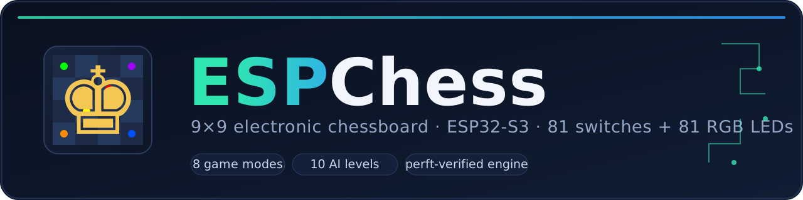
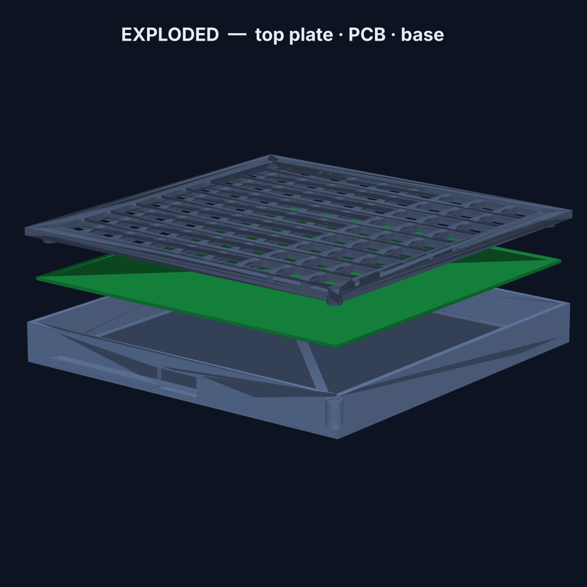
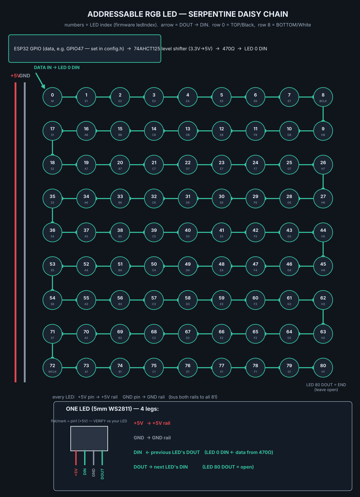
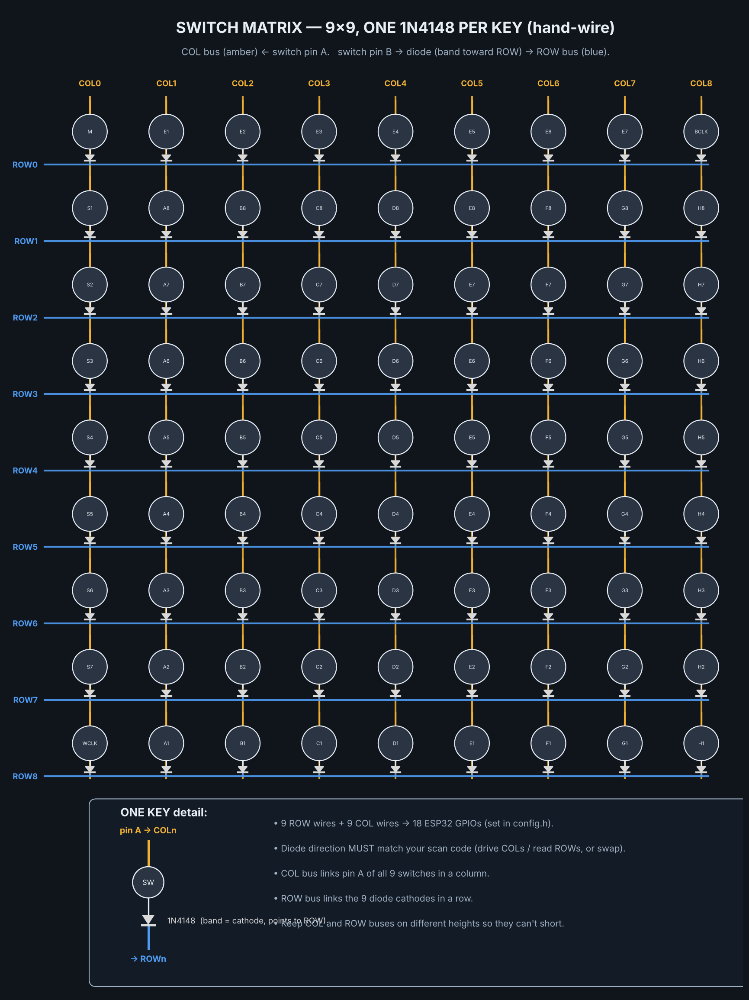

<div align="center">



<br/>

[](firmware/test)
[](firmware/test/perft_main.cpp)
[](platformio.ini)
[](https://platformio.org/)
[](LICENSE)

**A hand-built 9×9 electronic chessboard** — 81 mechanical key switches, one
addressable RGB LED per square, and an ESP32-S3 running a full chess engine with
variants, clocks, selectable-strength AI and a championship ladder.

</div>

---

## Highlights

- ♟️ **Full chess engine** — legal move generation verified by **perft** (startpos
  depth 5 = 4,865,609 nodes; kiwipete depth 4 = 4,085,603). Castling, en passant,
  promotion, check / checkmate / stalemate, 50-move & insufficient-material draws.
- 🎮 **8 game types × 3 opponent modes = 24 configurations.**
- 🤖 **10 AI strength levels** (depth + blunder profiles) with a **championship
  ladder** — win advances, draw rematches, loss restarts at level 1.
- 🌈 **81 addressable RGB LEDs** — per-piece colours, active/waiting brightness,
  move highlights, check indicator, and an evaluation / clock bar on the edge
  segments.
- 🧪 **Portable, test-first core** — the chess/game logic has **zero Arduino
  dependencies** and is validated by a **71-assertion host test suite** before it
  ever touches hardware.
- 🔧 **Open hardware** — KiCad PCBs, 3D-printable plates, and hand-wiring diagrams
  all included.

## Game modes

| Game type | Rules | Clock |
|---|---|---|
| Standard | standard chess | untimed |
| Rapid | standard chess | 15 \| 10 |
| Blitz | standard chess | 5 \| 0 |
| Bullet | standard chess | 1 \| 0 |
| Puzzle | random legal position | untimed |
| Fog of War | enemy piece identities hidden | untimed |
| Horde | 36-pawn horde vs full army | untimed |
| King of the Hill | reach a centre square to win | untimed |

Each is playable as **2 Players**, **Vs AI** (level 1–10), or **Championship**.

## Repository layout

```
espchess/
├── firmware/            PlatformIO project (ESP32-S3, Arduino framework)
│   ├── include/ src/    portable game core + ESP32 HAL glue
│   └── test/            71-assert host suite, perft, play-through demo
├── hardware/
│   ├── pcb/             KiCad: plate board + control board, renders, BOM
│   ├── enclosure/       3D-printable top + bottom plates (STL + generator)
│   └── wiring/          hand-wiring diagrams (matrix + LED chain)
└── docs/                logo + design notes
```

## Hardware

Built on a **KP Republic 9×9 (182×182 mm) switch-tester plate**. Two routes are
provided: a **custom PCB** (plate board + small control board) or **hand-wiring**
the matrix and LED chain directly.

<div align="center">

</div>

**Per square:** 1× MX switch, 1× 1N4148 matrix diode, 1× 5 mm WS2811 addressable
RGB LED — **all through-hole, hand-solderable** (no SMD). The 81 LEDs are chained
in a serpentine order that matches the firmware's `ledIndex()`.

<table>
<tr>
<td align="center"><br/><sub>LED serpentine daisy-chain</sub></td>
<td align="center"><br/><sub>9×9 switch + diode matrix</sub></td>
</tr>
</table>

- **PCB** — [`hardware/pcb/`](hardware/pcb) · open the KiCad projects; see the
  [PCB README](hardware/pcb/README.md) for the matrix map, ribbon pinout and BOM.
- **Enclosure** — [`hardware/enclosure/`](hardware/enclosure) · a two-part printed
  case: switches snap into `top_plate.stl`, the PCB solders to them, and the unit
  screws into `base_enclosure.stl` (one-piece floor + walls + corner posts with M3
  heat-set inserts and a **12 mm battery bay** under the PCB).

> ⚠️ **Verify before building:** the GPIO map in
> [`firmware/include/config.h`](firmware/include/config.h) and the addressable-LED
> pinout are **provisional** — confirm both against your exact board and LEDs.
> Power the LEDs from an external 5 V supply (up to ~4 A at full white), never the
> ESP32 rail.

## Firmware

### Build & flash

```bash
# device (PlatformIO):
cd firmware
pio run            # compile for ESP32-S3
pio run -t upload  # flash
pio device monitor # 115200 baud
```

### Run the test suite on your PC (no hardware)

```bash
cd firmware
./run_host_tests.sh
```

```
71 unit/integration tests PASS   (0 fail)  — incl. all 24 game configs
20/20 perft positions PASS
```

### Playing

Tap your piece, then its destination (legal targets glow green), and press **your
clock** to commit the move. **M** resets the game. Mode selection is on the serial
console today (`g` game · `o` opponent · `l` level · `c` colour · `n` start) — an
on-board menu on the edge-segment LEDs is the next UI step.

## How it's verified

The engine is proven by **perft** — exhaustively counting the legal-move tree from
known positions and matching published node counts to the last node. On top of
that, the suite drives the real game controller through full games (scripted
checkmates, AI self-play to completion in every mode) and checks the clocks,
variants, LED mapping and championship ladder. See
[`firmware/test/`](firmware/test) and the captured
[test output](firmware/test/HOST_TEST_OUTPUT.txt) /
[play-through log](firmware/test/DEMO_PLAYTHROUGH.txt).

## Roadmap

- [ ] On-board menu (game type / level on the E1–E7 · S1–S7 segment LEDs)
- [ ] Under-promotion select (currently auto-queens)
- [ ] Puzzle-solving scoring semantics
- [ ] Hardware bring-up: confirm pinout, LED pinout, power, flash & play

## License

MIT — see [LICENSE](LICENSE).

<div align="center"><sub>Built for the love of over-engineering a chessboard. ♚</sub></div>
