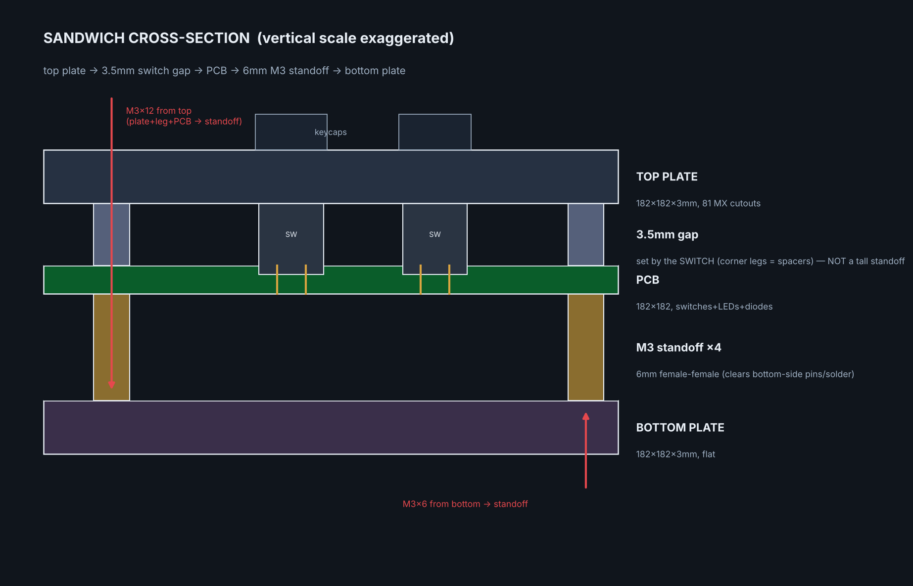

# ESPChess — Hardware

Everything to build the board, two ways: a **custom PCB** or **hand-wiring**.

## Contents

| Folder | What |
|---|---|
| [`pcb/`](pcb) | KiCad 8 projects — the **plate board** (`ChessboardPCB`, 182×182 mm, all 81 switches + LEDs + diodes) and the **control board** (`ChessboardCtrl`, ESP32 breakout + level shifter + power). Renders, BOM and matrix map included. See [pcb/README.md](pcb/README.md). |
| [`enclosure/`](enclosure) | 3D-printable `top_plate.stl` (switch plate) and `bottom_plate.stl`, plus `gen_plates.py` to regenerate them. |
| [`wiring/`](wiring) | Hand-wiring diagrams for the 9×9 matrix and the serpentine LED chain. |

## The sandwich

```
TOP PLATE (3 mm, 81 MX cutouts)
   └─ ~3.5 mm gap  ← set by the switches (printed corner legs keep it parallel)
PCB
   └─ 6 mm M3 standoff ×4
BOTTOM PLATE (3 mm, flat)
```



## Per-square parts (×81)

| Part | Value | Note |
|---|---|---|
| Switch | Cherry MX (or clone) | plate/PCB mount |
| Diode | 1N4148 (DO-35) | matrix anti-ghosting |
| LED | 5 mm WS2811 addressable RGB | through-hole; **verify 4-pin order** |

Plus one 470 Ω data resistor, a 74AHCT125 level shifter, a 1000 µF bulk cap, and
an external **5 V supply** (size for ~4 A at full white). Full BOM in
[`pcb/BOM.csv`](pcb/BOM.csv).

> ⚠️ The GPIO map and LED pinout are **provisional** — confirm against your exact
> board before committing solder.
