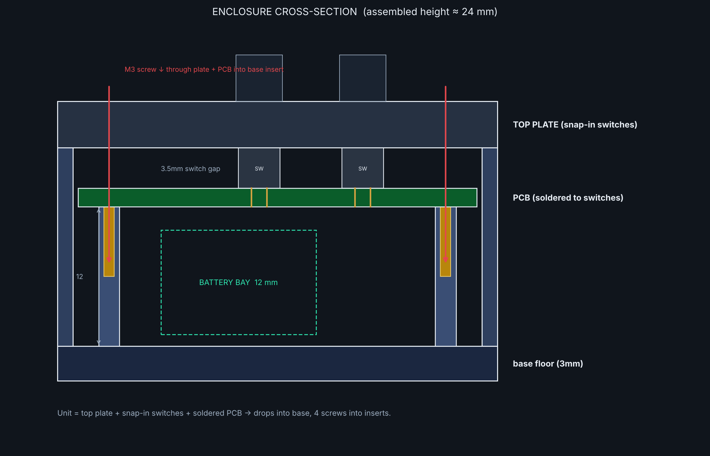
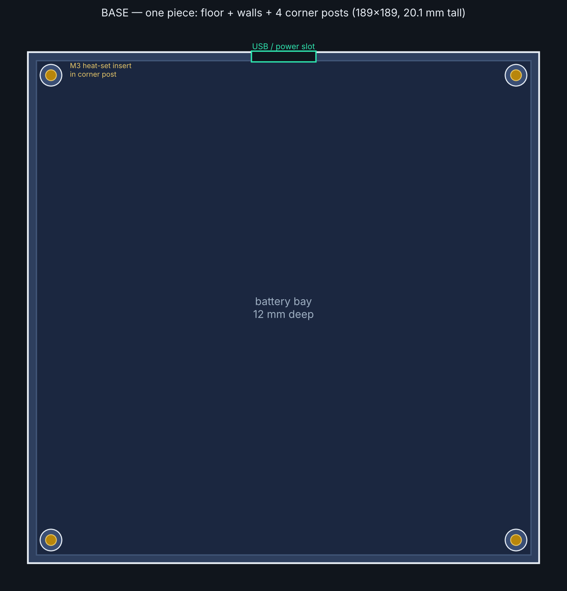

# ESPChess — Hardware

Everything to build the board, two ways: a **custom PCB** or **hand-wiring**.

## Contents

| Folder | What |
|---|---|
| [`pcb/`](pcb) | KiCad 8 projects — the **plate board** (`ChessboardPCB`, 182×182 mm, all 81 switches + LEDs + diodes) and the **control board** (`ChessboardCtrl`, ESP32 breakout + level shifter + power). Renders, BOM and matrix map included. See [pcb/README.md](pcb/README.md). |
| [`enclosure/`](enclosure) | 3D-printable two-part case — `top_plate.stl` (flat switch plate the switches snap into) and `base_enclosure.stl` (one-piece floor + walls + corner posts with a 12 mm battery bay). `gen_case.py` regenerates them. |
| [`wiring/`](wiring) | Hand-wiring diagrams for the 9×9 matrix and the serpentine LED chain. |

## The enclosure

The switches snap into the **top plate**; the **PCB is soldered to the switch
pins**, making plate + switches + PCB one rigid unit. That unit drops into the
**base** and is held by 4× M3 screws through the plate corners (and the PCB) into
**heat-set brass inserts** in the base's corner posts.

```
TOP PLATE (4 mm, 81 stepped MX cutouts, counterbored screw holes) — snap-in switches
   └─ 3.5 mm switch gap   (printed corner legs set it)
PCB (soldered to switches)
   └─ 12 mm battery bay    (open floor between the corner posts)
BASE (one piece: 3 mm floor + walls + 4 corner posts w/ M3 inserts)
```

Outer footprint 189 × 189 mm, assembled height ≈ 24 mm. A USB / power slot in one
wall opens into the battery bay.




**Hardware:** 4× M3 heat-set inserts (≈4.0 mm pilot), 4× M3×14–16 socket-head
screws. Print the top plate **web-side up** (the switch cutouts' 0.8 mm ledge
bridges without supports); print the base floor-down.

## Per-square parts (×81)

| Part | Value | Note |
|---|---|---|
| Switch | Cherry MX (or clone) | plate/PCB mount |
| Diode | 1N4148 (DO-35) | matrix anti-ghosting |
| LED | 5 mm WS2811 addressable RGB | through-hole; **verify 4-pin order** |

Plus one 470 Ω data resistor, a 74AHCT125 level shifter, a 1000 µF bulk cap, and
an external **5 V supply** (size for ~4 A at full white). Full BOM in
[`pcb/BOM.csv`](pcb/BOM.csv).

> ⚠️ The GPIO map and LED pinout are **provisional** — confirm against your exact
> board before committing solder.
